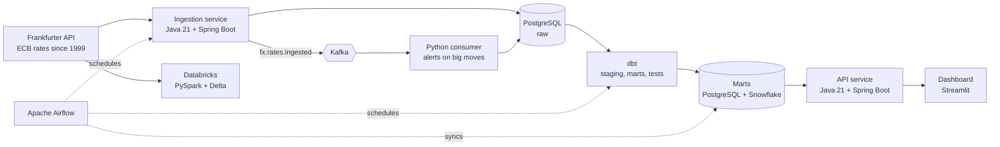

# FX Pulse

**An end-to-end data platform for European Central Bank exchange rates, built with Java, Python, SQL, Airflow, dbt, Snowflake, Databricks and Kafka.**

FX Pulse collects official ECB exchange rates every day, stores them without duplicates, turns them into useful numbers (daily returns, moving averages, volatility and alerts on unusual moves) and serves them through a Java REST API and a dashboard.

<!--  -->


> **Status:** in active development (October 2026 to January 2027). See the [roadmap](#roadmap) for what is finished and what is next.

---

## Contents

- [Why this project](#why-this-project)
- [Architecture](#architecture)
- [Tech stack](#tech-stack)
- [Quick start](#quick-start)
- [Components](#components)
- [Data model](#data-model)
- [Testing and quality](#testing-and-quality)
- [Roadmap](#roadmap)
- [What I learned](#what-i-learned)
- [Data source and license](#data-source-and-license)

---

## Why this project

Exchange rates are a simple dataset with real-world challenges: daily updates, gaps on weekends and holidays, more than 25 years of history, and calculations that must be exactly right. That makes them a good basis for showing how a production data platform works from end to end.

The project also builds on my master's thesis on DataFrame abstraction with Narwhals: the same business logic (moving window statistics and ratio calculations) is implemented once and **automatically verified across dbt, pandas, Polars, DuckDB, Snowpark and Spark**.

## Architecture



**Flow in short:**

1. The **ingestion service** (Java) fetches the daily rates and stores them in PostgreSQL. Re-running a day never creates duplicates.
2. **Airflow** runs the daily pipeline: ingest, data quality checks, dbt, and the sync to Snowflake.
3. **dbt** builds tested tables for cross rates, returns, moving statistics and alerts, on PostgreSQL and on Snowflake.
4. Every ingest sends a **Kafka** event; a Python consumer creates alerts for unusually large moves.
5. **Databricks** processes the full history with PySpark and Delta tables.
6. The **API service** (Java) serves the results, and the **dashboard** shows them as charts.

## Tech stack

| Area | Tools |
|---|---|
| Backend | Java 21, Spring Boot 3, Spring Data JPA, Spring Security, Spring for Apache Kafka, Flyway, Maven |
| Data processing | Python 3.12, pandas, Polars, DuckDB, Narwhals, PySpark |
| Storage | PostgreSQL 16, Snowflake, Delta Lake (Databricks) |
| Orchestration | Apache Airflow |
| Transformation | dbt Core (dbt-postgres, dbt-snowflake), dbt_utils |
| Streaming | Apache Kafka (KRaft mode) |
| Testing | JUnit 5, Mockito, Testcontainers, WireMock, pytest, dbt tests |
| DevOps | Docker, Docker Compose, GitHub Actions, GitHub Container Registry, Kubernetes (kind) |
| Monitoring | Spring Boot Actuator, Micrometer, Prometheus, Grafana |
| Visualisation | Streamlit |

## Quick start

### Requirements

- Docker Desktop (with Docker Compose)
- JDK 21 and Python 3.12 (only for local development without Docker)

### Run everything

```bash
git clone https://github.com/<your-username>/fx-pulse.git
cd fx-pulse
cp .env.example .env
docker compose up -d
```

### Load the history (once)

```bash
curl -X POST "http://localhost:8081/api/backfill?from=1999-01-04&to=2026-10-01"
```

### Open the services

| Service | URL |
|---|---|
| Ingestion service (health) | http://localhost:8081/actuator/health |
| API service (Swagger UI) | http://localhost:8082/swagger-ui.html |
| Airflow | http://localhost:8080 |
| Dashboard | http://localhost:8501 |
| Grafana | http://localhost:3000 |

## Components

### Ingestion service (`ingestion-service/`)

Java 21 and Spring Boot service that loads ECB rates from the [Frankfurter API](https://frankfurter.dev).

| Endpoint | Description |
|---|---|
| `POST /api/ingest?date=YYYY-MM-DD` | Loads the rates for one day |
| `POST /api/backfill?from=YYYY-MM-DD&to=YYYY-MM-DD` | Loads a date range, year by year |

- Runs automatically every working day at 16:30 CET, after the ECB publishes its rates.
- **Idempotent:** loading the same day twice adds no duplicates (unique key on date, base and quote currency).
- Database structure versioned with Flyway.
- Publishes a `fx.rates.ingested` event to Kafka after each successful load.

### Orchestration (`airflow/dags/`)

| DAG | What it does |
|---|---|
| `fx_daily` | Health check, ingest for the run date, then `dbt build` |
| `fx_quality` | SQL checks: rows per day, no empty values, rates above 0, no duplicates |
| `fx_snowflake_sync` | Loads new days into Snowflake and runs dbt on the Snowflake target |

### Transformations (`dbt/fx_pulse/`)

| Model | Layer | Description |
|---|---|---|
| `stg_fx_rates` | Staging | Clean names and types, duplicates removed |
| `dim_currency` | Dimension | Currency codes and names (from a seed file) |
| `int_fx_cross_rates` | Intermediate | Non-EUR pairs, for example USD/GBP from EUR/USD and EUR/GBP |
| `fct_daily_returns` | Mart | Daily % change and log return per pair (incremental) |
| `fct_moving_stats` | Mart | Rolling mean, standard deviation and variance over 7, 30 and 90 days |
| `fct_fx_alerts` | Mart | Days where the move is above 2 standard deviations |
| `dim_currency_snapshot` | Snapshot | Change history of currencies (SCD Type 2) |

```bash
cd dbt/fx_pulse
dbt deps
dbt build --target postgres
dbt build --target snowflake
dbt docs generate && dbt docs serve
```

### Snowflake (`snowflake/`)

- The same dbt project runs on PostgreSQL and Snowflake; results are compared automatically.
- A Snowpark for Python version of the moving statistics runs inside Snowflake.
- Cost settings: X-Small warehouse with auto-suspend after 60 seconds.

### Databricks (`spark/`)

- PySpark notebooks build bronze, silver and gold Delta tables for the full history of all currencies.
- Gold tables are checked against the dbt marts.

### Streaming (`streaming/`)

- Python consumer (confluent-kafka) reads `fx.rates.ingested` events and writes alerts for large moves.
- Broken messages go to a dead-letter topic.

### API service (`api-service/`)

| Endpoint | Description |
|---|---|
| `GET /api/v1/rates/{base}/{quote}?from=&to=` | Rates for a currency pair and date range |
| `GET /api/v1/stats/{pair}?window=30` | Moving statistics for a pair |
| `GET /api/v1/alerts` | Recent alerts on unusual moves |

- OpenAPI documentation (Swagger UI), input validation, caching and API key protection.

### Analytics and dashboard (`analytics/`)

- `consistency_check.py` calculates the moving statistics with Narwhals on pandas, Polars and DuckDB and compares them with the dbt results.
- Streamlit dashboard with rate charts, rolling volatility and alerts, using data from the API service.

## Data model

```sql
-- raw.fx_rates: one row per date, base currency and quote currency
CREATE TABLE raw.fx_rates (
  id             BIGSERIAL PRIMARY KEY,
  rate_date      DATE          NOT NULL,
  base_currency  CHAR(3)       NOT NULL,
  quote_currency CHAR(3)       NOT NULL,
  rate           NUMERIC(18,8) NOT NULL CHECK (rate > 0),
  source         TEXT          NOT NULL DEFAULT 'ECB',
  ingested_at    TIMESTAMPTZ   NOT NULL DEFAULT now(),
  UNIQUE (rate_date, base_currency, quote_currency)
);
```

## Testing and quality

| Level | Tools | Command |
|---|---|---|
| Java unit tests | JUnit 5, Mockito, WireMock | `./mvnw test` |
| Java integration tests | Testcontainers (PostgreSQL, Kafka) | `./mvnw verify` |
| Python tests | pytest | `pytest` |
| Data tests | dbt tests, Airflow SQL checks | `dbt test` |
| Cross-tool checks | Narwhals, Snowpark, PySpark | `pytest analytics/` |
| Code style | ruff, pre-commit | `pre-commit run --all-files` |

Every push and pull request runs all tests in GitHub Actions, and Docker images are published to GitHub Container Registry.

## Repository structure

```text
fx-pulse/
|-- ingestion-service/      Java 21, Spring Boot: fetch and store rates, Kafka producer
|-- api-service/            Java 21, Spring Boot: REST API for rates, stats, alerts
|-- dbt/fx_pulse/           dbt project (targets: postgres, snowflake)
|-- airflow/dags/           fx_daily, fx_quality, fx_snowflake_sync
|-- analytics/              notebooks, consistency checks, Streamlit dashboard
|-- streaming/              Python Kafka consumer (alerts)
|-- spark/                  Databricks notebooks (PySpark, Delta)
|-- snowflake/              setup SQL, Snowpark scripts
|-- k8s/                    Kubernetes manifests for kind
|-- docs/                   architecture, decision records, screenshots
|-- .github/workflows/      CI pipeline
|-- docker-compose.yml
`-- README.md
```

## Roadmap

- [ ] Setup, data model and first analysis notebook
- [ ] Ingestion service with backfill since 1999 and tests
- [ ] Docker Compose and GitHub Actions CI
- [ ] Airflow DAGs with data quality checks
- [ ] dbt models: staging, cross rates, returns, moving statistics, alerts
- [ ] Cross-tool consistency checks with Narwhals
- [ ] Snowflake target and Snowpark version
- [ ] Databricks: PySpark and Delta tables
- [ ] Kafka events and alert consumer
- [ ] API service with OpenAPI, security and caching
- [ ] Kubernetes deployment with kind
- [ ] Dashboard, monitoring and demo video

## What I learned

*To be filled in as the project grows: one or two sentences per part, for example a data quality problem I caught, a design decision I would change, or something that surprised me.*

## Data source and license

- Exchange rates: European Central Bank reference rates via the free, open-source [Frankfurter API](https://frankfurter.dev). Rates are published once per working day; weekends and holidays have no new rates.
- This project is licensed under the MIT License. See [LICENSE](LICENSE).

## Author

**Romina Nikasa**, Data Engineer and Java Developer
[LinkedIn](https://www.linkedin.com/in/<your-profile>) | [GitHub](https://github.com/<your-username>)
