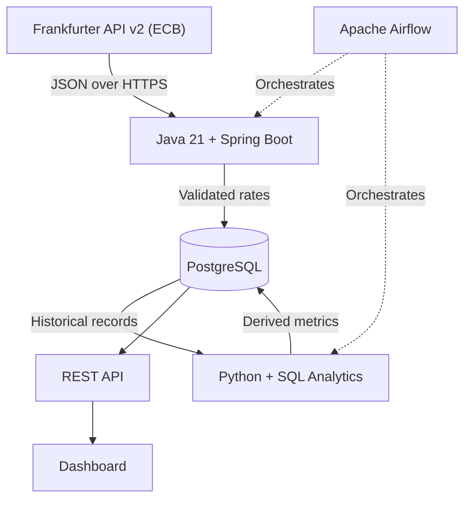

# FX Pulse - System Architecture

## 1. Overview

FX Pulse is a portfolio project for building a
reliable foreign-exchange reference-rate platform.

The application will ingest historical and daily
rates, store them in PostgreSQL, calculate
analytical metrics, and expose results through
an API and dashboard.

Status: Architecture planned; implementation in progress.

## 2. System Diagram

## 3. Components

### External Source

Frankfurter API v2, ECB provider.

Provides historical and daily reference rates
as JSON observations.

### Java Ingestion Service

Planned responsibilities:

- Call the Frankfurter API
- Parse exchange-rate responses
- Validate required fields
- Convert records to the internal model
- Store observations in PostgreSQL
- Handle retries, errors, and duplicate ingestion

### PostgreSQL

Stores exchange-rate observations with
a composite primary key.

A raw schema will hold ingested observations.
Analytical tables will be added later.

### Python and SQL

Calculate:

- Daily percentage changes
- Five-observation moving averages
- Volatility metrics

### Apache Airflow

Will schedule and orchestrate ingestion,
transformations, and quality checks.

### REST API and Dashboard

Will provide access to historical rates,
calculated metrics, and visualizations.

## 4. Why PostgreSQL?

PostgreSQL was selected because:

- FX observations have a structured relational model.
- Primary keys prevent duplicate observations.
- NUMERIC supports exact decimal storage.
- SQL supports historical and window-based analysis.
- PostgreSQL integrates with Java and Python.
- It can run locally using Docker.

## 5. Data Integrity

The platform should:

- Reject invalid or incomplete observations.
- Preserve the source observation date.
- Store the provider alongside every rate.
- Avoid duplicate rows during repeated ingestion.
- Flag conflicting values for the same primary key.
- Distinguish missing publication dates from failures.

## 6. Planned Future Extensions

After the core MVP:

- Snowflake: optional analytical warehouse
- dbt: transformation models and tests
- Kafka: event-driven extensions
- Spark: distributed historical processing
- Databricks: managed data engineering workflows
- Kubernetes: deployment experiments

